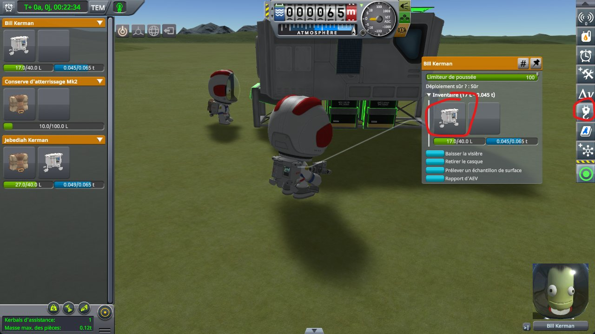
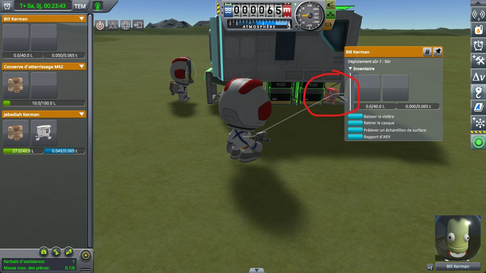
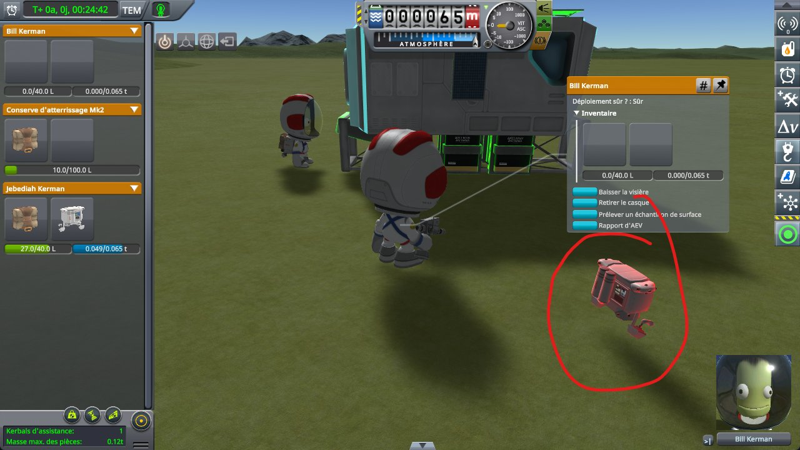
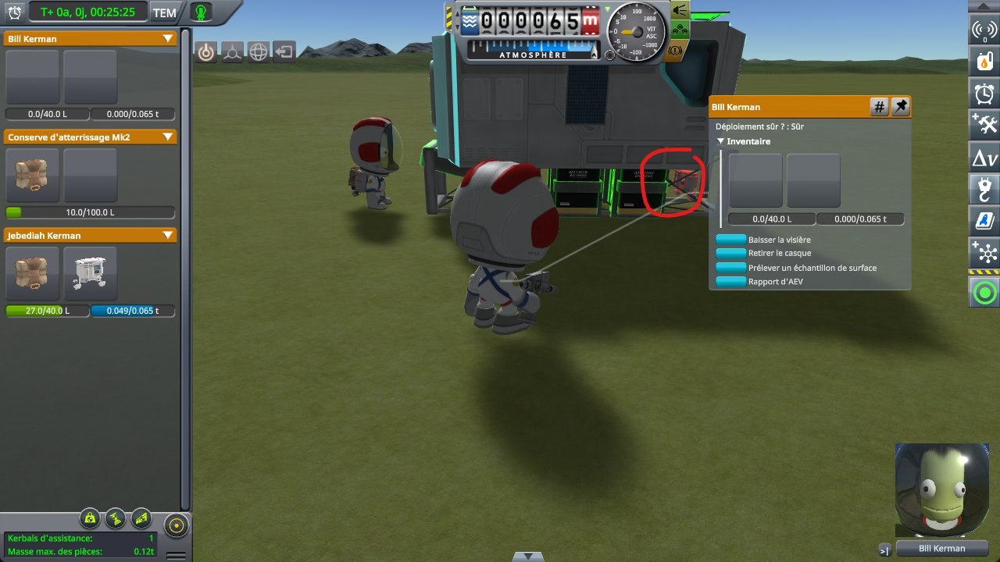
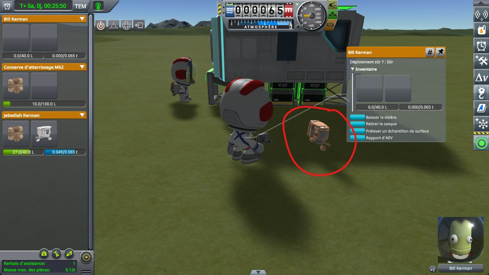

# Construction Panel Hover Fix

**⚠️ Not finished yet.** This is a new fix, not a finished mod. The code and the conclusions on this page can still change.

A fix for stock KSP 1.12, kept as small as possible: one Harmony patch, in one source file. It is a mod of its own,
built on top of [KSP Community Fixes](https://github.com/KSPModdingLibs/KSPCommunityFixes), the base most players
run. Here is what it fixes:

> **In EVA construction mode, a part in hand can stay red everywhere after the mouse went over a part action window
> or the construction panel.** If the part was touching another part at that moment, it stays red when the mouse
> comes back, even far from anything, and cannot be placed any more. Touching the same part again, then moving away,
> makes it placeable again.

**How this was made.** The investigation and the code were written with Claude, Anthropic's AI
assistant. Everything here was reviewed and validated by a human — me. I am saying so up front, because
contributions made with an AI deserve a closer look than others, and because some people would rather
stop reading here. That look should be quick: the stock code involved is named and quoted on this page, and the fix
is one source file you can read in a few minutes.

## Why it matters

Inventories are reached through part action windows, and a player building in EVA keeps them open next to the
vessel being worked on. A part taken from one of them is often pushed against that vessel, and the mouse goes back to
the window to fetch the next part. The player gets no hint of what went wrong: the part is red on bare ground, and
nothing nearby explains it. Most players put the part back into an inventory, or reload, without knowing that
touching the part it was against, then moving away, would have fixed it.

## The culprit

Three stock pieces, each harmless on its own:

- **`Part.OnTriggerEnter`** and **`Part.OnTriggerExit`** keep the list of what the held part touches,
  `Part.cargoColliders`: a collider is added when a contact starts and removed when it ends, and nothing else
  removes it.

- **`EVAConstructionModeEditor.UpdatePartPlacementPosition`** turns the held part red as long as that list holds a
  collider of another part, or one that belongs to no part (the ground):

  ```csharp
  // EVAConstructionModeEditor.UpdatePartPlacementPosition (KSP 1.12), simplified
  int count = selectedPart.cargoColliders.Count;
  while (count-- > 0)
  {
      ...
      Part partUpwardsCached = FlightGlobals.GetPartUpwardsCached(selectedPart.cargoColliders[count].gameObject);
      if (partUpwardsCached != null)
      {
          if (attachment.potentialParent == null)
          {
              isPlacementValid = false;
              ...
  ```

- **`UIPartActionControllerInventory.UpdateSelectedPartVisibility`** hides the held part while the mouse is over the
  construction panel or a part action window, by deactivating it, and shows it again when the mouse leaves:

  ```csharp
  // UIPartActionControllerInventory.UpdateSelectedPartVisibility (KSP 1.12)
  flag = !IsCursorOverAnyPAWOrCargoPane;
  ...
  CurrentCargoPart.gameObject.SetActive(flag);
  ```

Unity does not report the end of a contact for a collider that is deactivated. When the held part is hidden while it
touches something, its contacts are never removed from the list: the part comes back red wherever the mouse puts it.
Only a new contact with the same collider, followed by its end, removes the stale entry.

## Checking the culprit

KSP 1.12.5 with [KSP Community Fixes](https://github.com/KSPModdingLibs/KSPCommunityFixes) 1.41.1. Copy
[construction-panel-hover.sfs](diag/construction-panel-hover.sfs) into the folder of a sandbox game and load it: Bill,
an engineer, is on EVA north of the runway, next to a rover without wheels, with a jetpack in his inventory.
Jebediah, on EVA too, stands nearby.

Then, by hand:

1. Open the construction mode, and pick the Place tool.
2. Right-click Bill to open his part action window, and drag it next to the frame under the rover.
3. Click the jetpack in that window's inventory: it follows the mouse.
4. Move it into the frame under the rover, right next to the window: it turns red, which is expected.
5. Slide the mouse onto the window, without leaving the frame first: the jetpack disappears, and only its icon
   follows the mouse.
6. Leave the window by its bottom edge, away from the rover, move the mouse over bare grass, and click.

At step 6, leaving the window through the frame would make the jetpack touch it again, then leave it: that clears
the problem, as in [Getting out of it without this mod](#getting-out-of-it-without-this-mod).



*The save loaded, construction mode open, Bill's part action window next to the rover. The jetpack is circled in
his inventory.*



*Step 4: the jetpack in the frame under the rover, next to the window. Red, as it should be.*


*Step 5: the mouse over the window. The jetpack is hidden; only its icon follows the mouse.*



*Step 6, on stock: the jetpack on bare grass, away from everything.*

- **On stock:** the jetpack is still red on bare grass, and the click does not place it.
- **With this mod:** back on the grass, the jetpack is no longer red, and the click places it. In the frame, it is
  still red, as on stock.

## Getting out of it without this mod

Move the red part back against the part it was touching when it was hidden, then straight to where it should go,
without passing over a window or the panel: it can be placed again.



*The jetpack moved back into the frame under the rover.*



*Then straight over the grass: no longer red.*

## The fix

One patch, with its switch in [Settings](#settings), on by default. Nothing is saved; removing the mod gives the
stock behaviour back at once.

- **`hiddenPartContactsReset`.** A prefix and a postfix of `UIPartActionControllerInventory.UpdateSelectedPartVisibility`
  compare whether the held part was visible before and after the stock method. Each time it has just been hidden, or
  shown again, the postfix empties its `Part.cargoColliders`. If the part comes back touching something, the physics
  engine reports that contact again at the next physics step, and the part is red as on stock.

If a stock member is missing, nothing is patched, with an error in `KSP.log`.

**Why empty the list instead of checking each contact.** Checking would mean testing again, with our own geometry,
whether two colliders still touch: that is the physics engine's job, and a second opinion can disagree with it,
for instance against the concave mesh of the ground. Emptying the list when the part is hidden leaves that judgement
to the physics engine, which reports every real contact again once the part is shown.

**Why only when the part is hidden or shown.** It is the only moment found where a contact goes stale on stock. A
collider deactivated by something else while the held part touches it (a mod that switches colliders off, for
instance) would leave the same stale entry; this mod does not cover it.

## Work in progress

What a player would see if this mod broke something, or what it should fix but was not checked yet, and how to try
it by hand, with the mod and without:

- **The construction panel instead of a part action window.** As in [Checking the culprit](#checking-the-culprit),
  but with the jetpack taken from the construction panel, and the mouse slid onto the panel at step 5. The rover must
  touch the edge of the panel on screen, so that the jetpack is still in the frame when the mouse reaches the panel.
  On stock, the jetpack should stay red the same way; with the mod, it should be placeable on the grass.
- **A part detached from a vessel.** As in [Checking the culprit](#checking-the-culprit), but with a part of the
  rover, detached with the Place tool, instead of the jetpack. Same results expected.
- **A part pushed into the ground.** A part held low enough to touch the ground, hidden over the panel, then brought
  back over flat ground: on stock it stays red; with the mod, it should be placeable.
- **Time warp with a part in hand** should change nothing, with the mod or without.

## Install

Copy the `GameData\KSPFixConstructionPanelHover` folder into the `GameData` folder of KSP. It needs
[Harmony](https://github.com/KSPModdingLibs/HarmonyKSP), as KSP Community Fixes does.

## Settings

`GameData\KSPFixConstructionPanelHover\PluginData\settings.cfg` is read once, when KSP starts:

```
// Forgets the contacts of a held part when the game hides it or shows it again.
hiddenPartContactsReset = True

// How much the mod writes to KSP.log: Error, Warning, Info or Debug.
logLevel = Info
```

- With `hiddenPartContactsReset = False`, nothing is patched: the part stays red as on stock.
- At `Debug`, the mod writes one line each time it forgets contacts, with their names.

## Build

Set `KSPDIR` to the folder of a KSP install with Harmony in its `GameData`, then run `build.bat`: it
compiles `GameData\KSPFixConstructionPanelHover\KSPFixConstructionPanelHover.dll`. Installing is up to you.

## License

[MIT](LICENSE).
